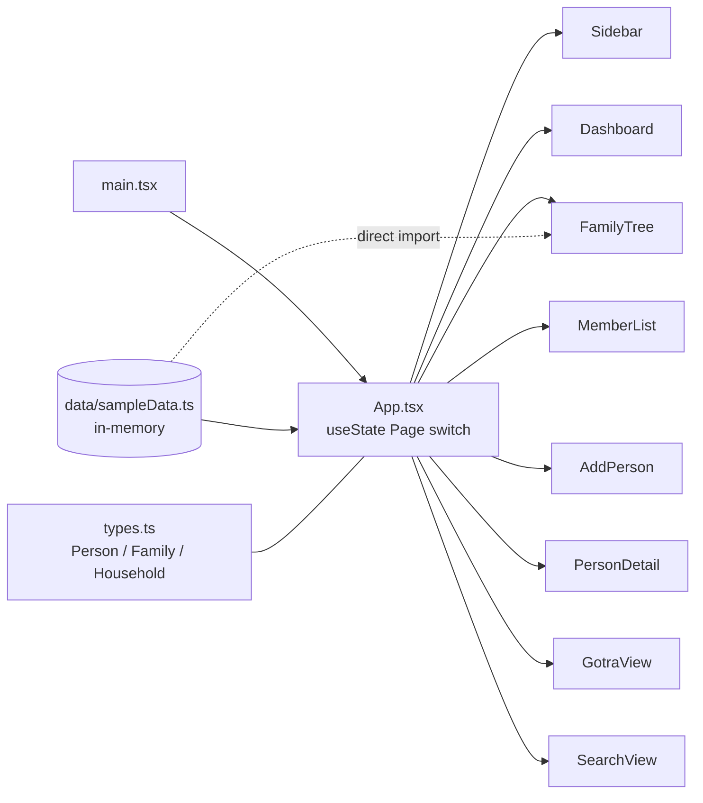
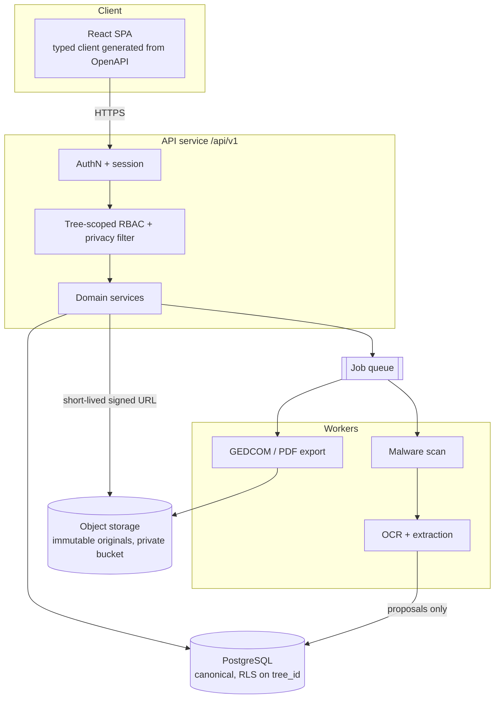

# Architecture

Status: **baseline written at project start**. It records what exists today, the proposed
target, and the decisions still open. ADRs in `adr/` are *Proposed* until the owner accepts them.

| Doc | Purpose |
|---|---|
| [domain-model.md](domain-model.md) | Entity graph (Mermaid) for Person, Relationship, Household, FamilyBranch, Event, Place, Source, Citation, Document, Property, LandParcel, PropertyInterest, PropertyEvent |
| [open-questions.md](open-questions.md) | Requirements review (grill-me output): decisions the owner must make |
| [adr/](adr/) | Architecture Decision Records |
| [../security/threat-model.md](../security/threat-model.md) | STRIDE threat model and required negative tests |
| [../security/privacy-model.md](../security/privacy-model.md) | Living-person, child and sensitive-field privacy rules |

## 1. Current state (repository exploration)

Findings that affect the target design:

| # | Finding | Location | Consequence |
|---|---|---|---|
| F1 | Parent links live on `Person` (`fatherId`, `motherId`), and `spouseIds`/`childrenIds` are stored in both directions | `src/types.ts` | Can't represent adoption, step, foster, *dattak* or niyoga parentage. Can't record multiple or ordered marriages, marriage dates or divorce. The two sides can drift apart (see F2). |
| F2 | `AddPerson` sets `fatherId`/`motherId` but never updates the parent's `childrenIds` or anyone's `spouseIds` | `src/components/AddPerson.tsx` | Tree views that walk `childrenIds` don't show new people. Store relationships as a single edge (ADR-0003). |
| F3 | `gender: 'male' \| 'female'` only; parent pickers filter by gender | `types.ts`, `AddPerson.tsx` | Excludes unknown gender (common in old records) and non-binary people. Parent role should not be inferred from gender. |
| F4 | New people default to `isPrivate: false` and `isLiving: true` | `AddPerson.tsx` | A living person is public by default, which breaks the privacy model. Living people must be private by default. |
| F5 | `isPrivate` is only a display badge. No code enforces it. | `PersonDetail.tsx`, `MemberList.tsx` | This is fine with no backend. Real enforcement must happen on the server (privacy-model §3). |
| F6 | Dates are free ISO strings | `types.ts` | Can't express "abt 1890", "bef 1920", Vikram Samvat/Saka dates or tithi. Need a genealogical date type (ADR-0003). |
| F7 | `FamilyTree` imports `sampleHouseholds` directly | `FamilyTree.tsx` | The component is tied to fixture data. Pass households in as props or load them from the API. |
| F8 | Only one `Family` per app, and no tree/tenant concept | `App.tsx` | Multi-tree isolation is needed before the backend exists (ADR-0002). |
| F9 | `react-router-dom` and `@supabase/supabase-js` are unused dependencies | `package.json` | Choosing a backend (Supabase vs a custom API) is an open question (Q1). |

## 2. Proposed target architecture

The main decisions are in the ADRs:

- [ADR-0001](adr/0001-record-architecture-decisions.md): record decisions as ADRs.
- [ADR-0002](adr/0002-canonical-relational-store-and-tree-isolation.md): PostgreSQL is the canonical store and every row carries `tree_id`.
- [ADR-0003](adr/0003-relationships-as-typed-edges.md): relationships are typed, dated, sourced edges.
- [ADR-0004](adr/0004-document-pipeline-and-provenance.md): document pipeline, with OCR output only ever proposed.
- [ADR-0005](adr/0005-property-modelling.md): ancestral property is modelled as parcels, interests and events.

## 3. Critical browser (Playwright) flows

These must pass end to end before a feature counts as done:

1. Register → Login → Create Tree → Add Person → Add Parents → Add Spouse → Add Child → View Tree
2. Upload Birth Certificate → Process → Review Extracted Values → Accept/Reject Fields
3. Create Property → Add Parcel → Link Ancestor → Upload Partition Deed → Add Partition Event → View Property Timeline
4. Viewer attempts an unauthorised edit → the UI denies it → a direct API request is denied too (403/404)

## 4. Suggested build order

1. Backend skeleton, auth, trees and memberships (RBAC), then Person + Relationship with migrations and authz tests.
2. Replace the in-memory state with API calls behind a typed client. Fix F2–F4 on the way.
3. Events, Places, Sources, Citations, GEDCOM import/export.
4. Document vault and OCR proposals.
5. Households, branches and the Joint Family view.
6. Property register and timeline.
7. Large-tree performance: virtualised rendering, recursive-query indexes.
