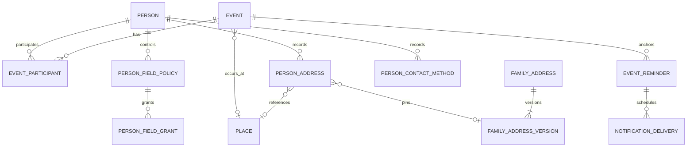

# ADR-0031: Family profile fields, private addresses and communications

- Status: **Proposed — not accepted, not implemented** · 12 November 2026.
- Requested scope: [brief](../family-profile-communications/brief.md).
- Evidence: [repository audit](../family-profile-communications/audit.md).
- Proposed amendments to ADR-0003 (withheld date state), ADR-0006 (sensitive field policy),
  ADR-0019 (reverse PIN suggestions), ADR-0021 (address/contact review targets), ADR-0016
  (event-edit rescheduling and explicit channel-purpose consent).
- ADR-0027's record-only audiences remain record-only. No amendment is accepted by this file.

## 1. Context and boundaries

The application already stores multilingual names, competing birth events, genealogical dates,
event times, places, ancestral assertions, households, verified notification contacts, invitations
and reminders. Missing capabilities are structured multi-address associations, private reuse,
typed profile contacts and an integrated editing journey. Existing person field privacy also admits
tree administrators; the new brief requires private information to survive role changes without
gaining readers. The full evidence and concurrent PRs are in the audit.

The source of truth stays relational. Global LGD/India Post rows remain public reference data;
private family data remains tree-scoped. Nothing in this proposal activates messaging or lunar
providers, imports unapproved datasets, merges PRs or deploys a service.

## 2. Birth facts and focused editing

1. Birth date, time and place remain fields of the **same existing birth event**. A profile shows
   the preferred event plus a visible link to other authorized claims. An action carries the exact
   event ID and revision. With no birth event, explicitly create one; a failed lookup never silently
   becomes a new birth. With competing claims, name the selected claim and retain all others.
2. Provide three actions: **Edit date of birth**, **Edit birth time**, **Edit birthplace**. Reuse
   the event service and editor components; send only fields actually edited. Keep #74's inline
   action approach and fix its loading/missing-event state before incorporating it.
3. Date entry keeps `GenealogicalDate`: exact, month/year, year-only, circa, before, after, range,
   unknown, original text and lunar fields. Exact Gregorian entry may use a date picker or manual
   components; choosing another precision never pads absent components. Preserve competing claims.
4. Proposed addition: `event.date_withheld BOOLEAN NOT NULL DEFAULT false`. This records “the
   contributor deliberately did not supply the date”, not a second date. When true, `date` and
   derived sort bounds must be NULL. “Keep the known date private” changes field policy instead;
   it never clears the date. Replacing a recorded date with withheld needs explicit confirmation,
   records a protected revision and invalidates reminders. Unknown remains an unknown/null date.
5. Time stays `GenealogicalTime` plus event timezone/offset. Offer 12-hour + AM/PM and 24-hour
   entry, optional seconds, precision and source; citations give source detail. Empty time means
   unknown. Default timezone is empty, including create forms. An IANA zone or numeric offset is
   recorded only when the user supplies it. Retain the local time as written; do not normalize to
   UTC from current geopolitical boundaries or astrology. Validate updates as strictly as creates.
6. `birth_time` policy covers value, precision/source, timezone and offset. Time controls never
   become readable merely because the date is visible. Birthplace details, hospital text and exact
   coordinates need their own field check, independently of the date.
7. Direct writes, imports, extraction acceptance, proposal approval, history/revert and preferred
   claim changes use the same field guards and revision rules. A stale client gets a 409 with no
   partial write. Existing events are not silently preferred or replaced by adding a competing claim.

## 3. Field privacy: extend the central evaluator

### Proposed policy and ownership

Add `person_field_policy` for sensitive groups. It has `tree_id`, `person_id`, `group`,
`controller_membership_id` (nullable), `audience`, optional `audience_branch_id`, and `revision`.
Unique `(tree_id, person_id, group)`. Groups in this increment: `birth_date_full`, `birth_time`,
`birth_place_detail`, `contact`, `address`, plus `current_location`, `address_history`,
`ancestral_village`, `ancestral_house`. Other groups keep their current implementation.

This is a **field-policy type**, not `RecordPrivacyLevel` on a person. Audiences:

| Audience | Readers, subject to the person still being visible |
|---|---|
| `controller` | Current controller membership only |
| `members` | Controller and explicit, unexpired membership grants |
| `branch` | Controller and current members of the selected branch, without an admin exception |
| `family` | Current non-researcher-only tree members, as explicitly explained in the selector |

Add `person_field_grant` with policy, tree and grantee membership composite FKs, expiry and unique
`(policy_id, membership_id)`. Removal cascades grants; re-invitation never restores them. Public
requests never receive these private contact/location/time groups. Person-level visibility is an
additional ceiling, never bypassed by a field grant. Date redaction retains current year-only
semantics unless the recorded date is unknown/withheld.

The accepted claimant is controller when they have a current membership. Before claim, the
recording contributor's current membership is controller. Neither tree ownership nor a platform
role confers control. An accepted claim transfers sensitive-field control to the claimant and
resets these audiences to controller-only; the claimant may then explicitly re-share. This can
remove the contributor's access and must be explained before the claim is completed. A minor has
no self-claim shortcut; no guardian control is invented. Existing guardian/legal work remains gated.

If the controller leaves, controller becomes NULL; existing explicit readers may read but cannot
widen, edit or recover ownership. No admin takeover. Transfer before departure requires a named
membership's acceptance. Recovery after departure needs a separate decision, not an implementation
shortcut. Erasure remains a system operation under the existing consent process.

### Enforcement and management

`can_view_field` in `app/authz` resolves the new policy before legacy defaults. Add a central
`can_edit_field`: normal write/branch permission **and** field control/explicit edit delegation
are required; view grants alone never grant write. A claimant may manage their own field policy
under the existing self-privacy right; this does not automatically confer genealogy editing roles.
V1 has no edit delegation: the controller with write permission edits, or requests the required
role; new delegation can be considered later. Reviewers need visibility of every changed field
and cannot self-approve. A review role never reveals private proposal payloads.

Only the controller widens policy, with a server-computed audience preview and explicit confirmation
bound to the policy revision. Admins cannot overwrite the new policies through legacy
`field_privacy`, grants or person PATCH. Every protected read/write path uses the same evaluator:
detail/list/search, events, history, proposals/comments, source previews, calendar/ICS, exports,
render payloads, address pickers and delivery. Current-location output is an allowlisted city/state/
country projection: no private address ID, house label, PIN, street, source text or coordinates.

### Existing-data migration — decision requiring acceptance

Recommend **narrowing**, with an operator preview containing counts only:

- For each existing sensitive group, choose the current claimant membership, else the current
  original contributor membership, **only if that candidate can already read that field under
  the pre-migration person and field policies**. Otherwise controller is NULL. Check each group
  separately; having created a person does not prove access to that person's private fields.
  The resulting readership must be a subset of the pre-migration readership. No admin fallback
  or inference from kinship, and no silent recovery of access once removed.
- New policies default to controller-only, even where legacy defaults admitted admins. Do not
  copy broad person grants into sensitive-field grants. Existing data stays intact; authorized
  controllers can explicitly re-share after a clear migration notice.
- This deliberately removes some old access. Until this migration and every consumer are ready,
  the new privacy UI stays off and legacy screens must not promise role-independent privacy.
- Keeping old role-based access indefinitely would fail the requested promotion-invariance test;
  silently relabelling old levels “Only me” is rejected.

## 4. Smart address form and geography

One controlled `SmartAddressForm` composes existing `PlaceCascade`, `PlacePicker` and form
primitives. Its draft includes country, state, district, sub-district, settlement, optional
gram-panchayat text (not a verified code), locality, street, building, landmark, post office,
postal code, purpose and notes. All details are optional except the minimum needed to identify the
record; a rural village does not require a building or road. Non-India mode uses manual postal
fields and never enforces the six-digit Indian rule. No live device location is requested.

- For India, query existing `/geo/pincodes/{pin}` only after six digits satisfying the existing
  API rule. Debounce requests and discard responses for older PIN/country/snapshot selections.
- Show snapshot attribution/date, offices and district/state candidates. A unique upper level may
  be selected into an **untouched draft field**, visibly labelled as suggested. Never choose a
  village, building or street from a PIN. Multiple offices require the user to choose or keep manual
  entry; even one office is not proof of the person's residence.
- An occupied field is never overwritten automatically. A mismatch shows “Keep my details” and
  “Use suggested details”; both are explicit. Changing a parent clears only dependent reference
  selections, with a preview before changing recorded text. Manual historical text is preserved.
- Add an additive reverse lookup under existing `/geo`: `GET /geo/pincodes?level=&code=&cursor=`.
  Query existing `pincode_office` state/district/sub-district references under the active snapshot.
  Village/town queries may return **district candidates**, clearly marked as such; never claim an
  exact village-to-PIN mapping absent verified source evidence. Return empty/unavailable with manual
  entry if the source cannot support the request. Do not add a guessed many-to-many village map.
- Alias search and village disambiguation use existing LGD level/code/ancestor paths. No second
  importer; no approval bypass. Test fixtures are labelled synthetic and isolated from development
  family data. PIN 226001 in the brief is a UX example, not a hard-coded geographic fact.

Private street/hospital/address text never goes into globally searchable geo rows or unrestricted
tree Place names. Existing private-looking place data is not automatically parsed or reclassified;
inventory it for explicit remediation before claiming a tree is fully migrated.

## 5. Address, ancestral and reuse model

### Entities and constraints

| Entity | Purpose and required invariants |
|---|---|
| Existing `place` | Geographic/historical label, local names, LGD reference and provenance; not a private postal payload |
| `person_address` (new) | Tree/person association, purpose, explicit current/former status, optional `place_id`, captured public administrative labels, encrypted postal payload, optional from/until `GenealogicalDate`, source/citation references, revision, creator/updater, withdrawn_at |
| `family_address` (new) | Explicit reusable family/branch postal record; controller membership, audience/grants through a typed adapter to the central privacy evaluator, optional branch/household/property/place references, revision, retired_at; no owner/property-rights inference |
| `family_address_version` (new) | Immutable encrypted address snapshot, administrative labels and source provenance; unique `(family_address_id, version)`; all references use same-tree composite FKs |
| Existing `assertion` | Canonical person/branch `ancestral_village` with `place_id`, historical text and evidence. No new parallel ancestral-village fact table |

Purpose is controlled: current residence, permanent, previous residence, ancestral home, native
place, correspondence, other. **Birthplace is a projected birth-event card**, edited through the
birthplace action, never stored again in `person_address`. A person may have several current
residences; do not guess one based on latest insertion. Optional `is_primary_current` has a partial
unique index per tree/person among active current residences. Current city shows only an explicitly
selected primary address, or an authorized list of current cities; never a fabricated single city.

Unknown/approximate validity dates remain JSON with original text; no invented day bounds.
Definitely reversed intervals are rejected; uncertain overlap is allowed and displayed. Status is
explicit, not inferred solely from an approximate date. Use optional existing residence-event ID
as a source reference, not an automatically synchronized second fact. No residence event is created
merely by adding/correcting a postal record; explicit “Record relocation event” is a separately
confirmed action. Derived date bounds are for sorting only.

All new family tables get tree RLS, composite foreign keys, bounded strings/payload sizes and
indexes for person/purpose and branch. No global uniqueness on address text. Duplicate place
suggestions compare authorized geography references and recorded labels; the user chooses reuse,
and historical variants remain valid. An idempotency key prevents retry-created duplicate addresses.

### Link, copy, correct and move

- **Link geographical place:** existing `place_id`; freeze as-recorded label and snapshot reference.
- **Link family address:** pin an explicit immutable family-address version. A shared correction
  creates another version, shows an authorized affected-members preview and asks before adoption.
  History stays pinned. Counts and names are filtered; no hidden-member counts.
- **Copy:** create an independent encrypted payload. Editing it never updates its source. Retain
  provenance and a source-policy ceiling; independent values do not imply permission to re-share.
  Revalidate source/target visibility at commit. Revocation, source erasure and membership removal
  apply to linked and copied derivatives; do not retain an unauthorized copy as a back door.
  Source policy tombstones persist while derivatives exist; source deletion does not drop the
  ceiling. Copy chains carry the original ceiling, not just the immediate parent.
- **Correct:** update one record with optimistic concurrency, encrypted before/after history and
  reason. Default does not mutate another person's address or all references to a place.
- **Move:** in one transaction lock the person/current address, check revision and rights, mark
  the selected address former with its recorded end date and add the new current address.
  Preserve old data by default. If changing the primary current address, update the partial-unique
  primary marker in the same transaction. Retry returns the original result. Never “close all
  current residences” implicitly.
- **Remove:** withdraw an association, preserving authorized history. Erasure purges encrypted
  payload/history and derivatives according to the consent workflow; it does not delete another
  person's address or property. Shared versions referenced by history cannot be hard-deleted.

“Use my address” requires an existing claimed/linked profile in this tree. Address pickers filter
before pagination, ranking and counts. Group only authorized results as My / Family / Branch /
Ancestral / Recent; recents store identifiers per member and re-authorize on every read. Shared
ancestral village assertions do not grant access to residential streets or ancestral house details.
Smart Add offers a branch ancestral assertion for **ancestral village**, with accept/choose/enter/
unknown; branch membership alone never creates the assertion, birthplace or residence.

## 6. Contacts and endpoints

Add `person_contact_method` with tree/person, controlled kind (email, mobile, WhatsApp, Telegram,
Instagram, legacy note), encrypted value, masked hint, purpose/language preference, revision and
provenance. Optional duplicate methods are allowed; an explicit preferred flag is unique per
person/kind. Validate kind-specific syntax without testing external account existence. Social links
use fixed HTTPS host construction and validated usernames, never arbitrary executable URLs.

“WhatsApp same as mobile” copies the confirmed value into the draft; later mobile changes ask
whether to update WhatsApp. It does not link notification endpoints or establish consent.
Legacy contact free text is migrated verbatim into an encrypted legacy note, never parsed into
verified endpoints. Read responses mask by default; explicit reveal still requires the contact
field policy and is never logged with values. Contacts are excluded from public search and exports
unless an explicitly authorized private export supports them.

User-owned `notification_contact` remains separate. Store channel-specific verification and
revocable purpose consent (invitation / reminder), with notice version and timestamps. Reuse the
consent ledger where it can express subject and purpose; endpoint authorization remains tied to
the signed-in user. A profile contact may be offered to its claimant as an unverified draft;
verification and opt-in occur only through that user's action. No admin subscribes another adult.

## 7. Invitations and provider boundaries

One “Invite family member” panel asks whether this is an **email-bound tree membership invitation**
or a **claim this profile** invitation. Preserve existing allowed roles, branch scope, single-use
hashed tokens, expiry, consent and approval. Claim links still give no membership until approved.
Email-bound invitations retain their verified-recipient matching and pre-authorized roles; copying
their link does not bypass recipient identity checks. Do not silently replace one flow with the other.

Manual WhatsApp, Telegram, copy and native sharing carry generic text and a fragment-token claim
link, no personal preview data. UI state “Created” means created; a click/open cannot mean “Sent”.
Show accepted/expired/revoked from backend facts, delivery failed/sent only from an actual provider
attempt. Actual sends remain disabled without explicit operational authorization.

Telegram uses the official Bot API: user initiates `/start` with a short-lived, hashed, single-use
account-link nonce; verified webhook or controlled polling binds the returned private chat ID to
that signed-in user, then explicit channel consent. Username alone never delivers. Reject group
chats, replay, cross-account bindings and stale nonces; unlink invalidates pending sends.

WhatsApp reuses Meta adapter but separates authentication, invitation and reminder templates.
Before activation, verify current official policy, category, pricing, language and template
approval and record dated evidence. The existing runbook is not proof of current Meta approval.
SMS needs the same separate consent plus applicable Indian DLT entity/header/template evidence.
Instagram is a profile link only. Chatwoot remains deferred unless a human support inbox is requested.

## 8. Reminder correctness on edits

Keep the scheduler, `event_reminder`, preferences and delivery records. In the same transaction
as an accepted date/visibility/claim change, invalidate pending/retrying occurrences and recompute
affected subscriptions in each recipient's current context. An undeliverable date pauses scheduling
with a reason; it never guesses a day. Birth time is not consulted for a solar birthday.

Use one event-change service hook across direct edits, proposal apply/revert, preferred-claim
changes and deletion. A date edit that moves an occurrence earlier must wake scheduling before the
old `next_fire_at`. Add a scheduling generation to subscriptions/deliveries if required to detect
in-flight stale jobs; preserve unique logical delivery identity `(reminder, channel, occurrence,
lead)` so repeat ticks/edits cannot resend an already sent occurrence. Cancelled rows may be safely
re-armed only if no send attempt was accepted; ambiguous provider outcomes require reconciliation.

At delivery, recheck membership, event/date visibility, exact current occurrence, verified endpoint,
channel-purpose consent and generation immediately before provider invocation. Transactional
invalidations and consistent lock ordering serialize edits with delivery authorization; messages
already accepted by an external provider cannot be recalled. Do not hold a database transaction
across long retry delays. Tests must exercise both race orders, not only happy-path next-fire values.

Multiple marriage/birth claims remain separate event subscriptions. Never move a subscription to
a different preferred claim silently. Offer an explicit switch and atomically cancel the old
subscription if the user accepts. Lunar calculation retains ADR-0022 licensing/golden-data gates.

## 9. Migration, history and rollback

1. Land additive policy/withheld/schema support behind a feature flag, on the **then-current**
   single Alembic head. If #67 has merged, re-parent before publication. Never edit accepted old
   revisions or create a second head.
2. Backfill field policies after the approved count-only migration preview. Protect legacy fields
   immediately through the new evaluator before displaying new controls. API capability flags
   prevent older clients bypassing policies. A binary rollback that reads legacy fields broadly is
   unsafe and must be refused by deployment compatibility checks.
3. Add encrypted postal/contact structures and revision/proposal payload handling. Reuse core
   AES-GCM and associated-data primitives; bind ciphertext to tree/person/record purpose.
   Existing key management has fixed STANDARD/VAULT/SYSTEM key classes, **not** a version registry
   or in-place key rotation. V1 retains that limitation and its secret-manager/backup controls;
   it must not claim rotation is solved. Include an envelope format version for decoding future
   formats, which is not a key version. A future rotation facility needs its own reviewed
   re-encryption, interruption/recovery and backup/restore tests before keys can be retired.
   Extend the existing revision machinery rather than a second history service; redact before
   serializing diffs, and erase values on subject erasure. Audit holds field names/IDs only.
4. Move legacy address text verbatim to a single `other` record with unknown validity. Do not infer
   current city, household, country or PIN. Migration markers make retry idempotent. Contact text
   becomes one encrypted legacy note. Migrate old sensitive proposal/revision values too, or leave
   the new feature disabled until they are protected. Verify counts and decrypted equality in a
   restricted job without emitting values; never use a lossy parser as migration.
5. During transition the legacy API fields are authorized projections of the migrated legacy
   record, not an independently writable second source. Old-client writes go through the same
   service or receive a documented conflict; do not maintain divergent dual writes. Once migration
   is verified, clear plaintext originals and protect archive/backup restoration paths.
6. Each migration has a downgrade. Empty-state downgrade is tested; populated downgrade that
   discards history, ciphertext, grants or narrows/widens readers is refused atomically using the
   existing downgrade-guard pattern. Roll forward or restore an authorized compatible backup.
   Rollback cannot translate controller-only to legacy owner-readable `PRIVATE_SELF`.

Update the canonical domain/schema documentation with each actual migration. The diagram below
is **proposed**, not the current database:

## 10. Stress test and alternatives

| Challenge | Decision |
|---|---|
| A grantee is promoted to Owner | Explicit field membership audience unchanged; role cannot bypass policy |
| A contributor records an unclaimed adult's phone | New-record contributor control does not constitute the adult's consent; no send; claim later resets sharing |
| Original contributor currently cannot read an existing private field | Migration leaves control unset for that group; subset-of-existing-readers check prevents disclosure |
| Controller leaves and returns | New membership has no old control or grants; no admin recovery shortcut |
| A member edits a visible date while time is hidden | Patch date only; server rejects hidden-time modification; preserved time is not returned |
| Village is not in LGD, or India Post is unavailable | Manual entry, historical names retained, no invented reference codes |
| PIN suggests a different district | Warn and ask; retain typed fields unless explicitly replaced |
| A private address is copied then source access revoked | Independent values remain, but source ceiling prevents access/re-sharing; erasure propagates |
| Shared house correction changes 20 relatives | New immutable version; authorized impact preview and explicit adoption, history pinned |
| Two members move the same current residence | Lock/revision + idempotency; one succeeds, other gets conflict, no lost history |
| Event date changes while delivery queued | Invalidate generation and validate actual occurrence before send; never silently send old date |
| Legacy rollback re-exposes contact text | Fail-closed compatibility/downgrade guard, not a best-effort enum translation |

Rejected: a second DOB field; copying national geography into trees; private streets in Place;
using record-only privacy levels on person fields; automatic ancestral inheritance; unrestricted
copy/re-share; new scheduler; Telegram username delivery; unofficial WhatsApp automation.

## 11. Concrete owner decisions

The brief settles the feature priorities and no-inference/provider boundaries. Two policy choices
remain for acceptance of this proposal:

1. **Existing sensitive fields:** adopt the count-previewed narrowing in §3, with claimant or
   original contributor control only when already authorized for that field, otherwise no controller,
   and no admin recovery. Alternative: preserve legacy access visibly
   during a staged rollout, postponing the role-invariance acceptance criterion for those records.
2. **Private address copies:** independent values but retained source privacy/erasure ceiling (§5),
   rather than an irrevocable independent copy. Wider re-sharing would need a distinct source-owner
   release consent and is deferred.

Recommended: accept both conservative defaults. After acceptance, execute the focused increments
in the plan, beginning with privacy and the PR-A birth vertical slice. This is not a request to
activate external providers, merge or deploy.
