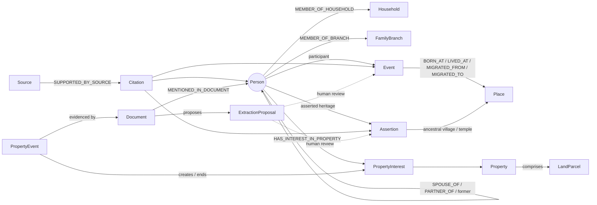
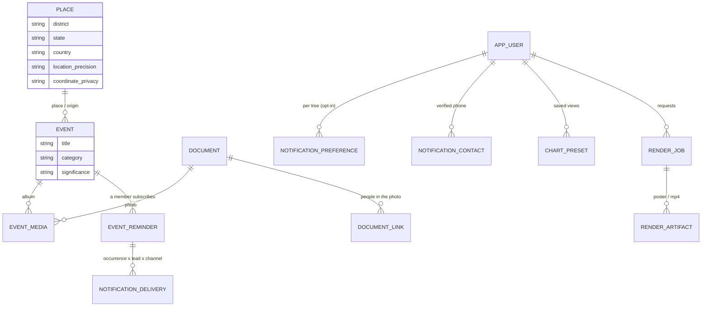

# Domain model

This document explains the model. The canonical schema is the SQLAlchemy models plus the Alembic
migrations (ADR-0002); [data-model.md](data-model.md) is generated from them. If this graph and the
schema disagree, the schema is right and this file needs fixing. The graph views below are
architectural aids and do **not** replace the relational model (no graph DB, ADR-0002).

Every tree-scoped entity also carries `tree_id`, `created_at/by` and `updated_at/by`. Every
cross-entity reference is a composite `(tree_id, id)` foreign key. These columns are left out of
the diagrams to keep them readable.

## 1. Entity relationship view

```mermaid
erDiagram
  USER ||--o{ TREE_MEMBERSHIP : holds
  TREE ||--o{ TREE_MEMBERSHIP : grants
  TREE ||--o{ TREE_INVITATION : issues
  TREE_MEMBERSHIP ||--o{ ADMIN_NOMINATION : "nominee (accepts; an Owner approves; ADR-0006)"
  TREE ||--o{ ACCESS_GRANT : "explicit shares"
  TREE_MEMBERSHIP ||--o{ ACCESS_GRANT : "held by (deleted with it, ADR-0027 §3)"
  TREE ||--o{ PERSON : contains

  PERSON ||--o{ NAME_RECORD : "has (type, script, language)"
  PERSON ||--o{ RELATIONSHIP : "person_a (parent / partner)"
  PERSON ||--o{ RELATIONSHIP : "person_b (child / partner)"
  RELATIONSHIP |o--o{ RELATIONSHIP : "union_id (child's parents' union)"
  PERSON ||--o{ RELATIVE_AGE_ORDER : "elder / younger (family-confirmed)"
  TREE ||--o{ TREE_VOCABULARY_TERM : "family's own entries"
  ASSERTION }o--o| VOCABULARY_TERM : "value_json names an entry (label kept)"
  PERSON ||--o{ EVENT_PARTICIPANT : participates
  EVENT ||--o{ EVENT_PARTICIPANT : has
  EVENT }o--o| PLACE : "occurs at / migrated from"
  PLACE }o--o| PLACE : "within (village → tehsil → district → state → country)"
  PLACE }o--o| GEO_UNIT : "lgd_level + lgd_code, picked in snapshot lgd_snapshot_id (never rewritten)"
  GEO_SNAPSHOT ||--o{ GEO_UNIT : "versioned rows: first_snapshot … last_snapshot"
  GEO_UNIT ||--o{ GEO_UNIT_ALIAS : "former / alternative names"
  PINCODE_OFFICE }o--o| GEO_UNIT : "suggests district (matched by name)"
  CHANGE_PROPOSAL ||--o{ CHANGE_PROPOSAL_ITEM : "items bound to base revisions"
  CHANGE_PROPOSAL_ITEM }o--o| PERSON : "changes a fact of (name, vital, claim, relationship)"
  PERSON ||--o{ RECORD_REVISION : "history: changed fields, before/after, actor, reviewer"
  APP_USER ||--o{ USER_NOTIFICATION : "ids only; text built when read"

  PERSON ||--o{ ASSERTION : "heritage claims (gotra, pravara, kula…)"
  FAMILY_BRANCH ||--o{ ASSERTION : "branch heritage"
  PERSON ||--o{ ASTROLOGY_PROFILE : "entered / chart / calculated / imported"
  FAMILY_BRANCH ||--o{ BRANCH_MEMBERSHIP : has
  PERSON ||--o{ BRANCH_MEMBERSHIP : "belongs (manual / derived)"
  FAMILY_BRANCH }o--o| PERSON : "founded by"
  FAMILY_BRANCH }o--o| FAMILY_BRANCH : "split from"
  HOUSEHOLD ||--o{ HOUSEHOLD_MEMBERSHIP : "members over time (karta, head…)"
  PERSON ||--o{ HOUSEHOLD_MEMBERSHIP : lives
  HOUSEHOLD }o--o| FAMILY_BRANCH : "of branch"

  SOURCE ||--o{ CITATION : "cited by"
  CITATION }o--|| CLAIM : "supports person / name / event / relationship / assertion / astrology / property*"
  DOCUMENT |o--o| SOURCE : "is evidence for"
  DOCUMENT ||--o{ DOCUMENT_LINK : "about person / event / place / property…"
  DOCUMENT ||--o{ DOCUMENT_DERIVATIVE : "preview, thumbnail, OCR text"
  DOCUMENT ||--o{ DOCUMENT_METADATA_VERSION : "metadata history"
  DOCUMENT ||--o{ EXTRACTION_PROPOSAL : "OCR proposals (never canonical)"

  PROPERTY ||--o{ LAND_PARCEL : comprises
  LAND_PARCEL |o--o{ LAND_PARCEL : "subdivided from"
  PROPERTY ||--o{ PROPERTY_INTEREST : "held as (rational share)"
  PROPERTY_INTEREST }o--o| PERSON : holder
  PROPERTY_INTEREST }o--o| FAMILY_BRANCH : holder
  PROPERTY ||--o{ PROPERTY_EVENT : history
  PROPERTY_EVENT ||--o{ PROPERTY_INTEREST : "creates / ends"
  PROPERTY_EVENT }o--o| EVENT : "linked life event (death → succession)"

  PERSON ||--o{ CONSENT_RECORD : "subject of"
  PERSON ||--o{ PROFILE_CLAIM : "claimed by user"
  PERSON ||--o{ PROFILE_CLAIM_INVITE : "shareable claim link (ADR-0011)"
  PROFILE_CLAIM_INVITE |o--o| PROFILE_CLAIM : "accepted as"
  TREE ||--o{ FAMILY_DATA_ATTESTATION : "contributor confirmed permission (ADR-0011)"
  PERSON ||--o{ MERGE_RECORD : "survivor / merged"
  TREE ||--o{ IMPORT_JOB : "GEDCOM imports"
  PERSON ||--o{ GEDCOM_EXTENSION : "preserved unknown tags"
  TREE ||--o{ AUDIT_EVENT : "append-only"
```

## 2. Graph view (conceptual relationships, PRS §47)

## 3. Rules the model enforces

| Rule | Where |
|---|---|
| No fixed parent/spouse columns. Every relationship is a typed edge. Multiple and overlapping unions are allowed. Children link to a specific union. | `relationship` + `union_id` (ADR-0003) |
| No self edges, no duplicate edges. Symmetric pairs are stored ordered. | DB `CHECK` / `UNIQUE`, service normalisation |
| No one can become their own ancestor | Recursive-CTE check before insert (`genealogy.service.is_ancestor`) |
| At most two non-disputed biological parents. More claims must be recorded as `DISPUTED`. | Service (409 `too_many_biological_parents`) |
| Siblings (full, half, step, adoptive) are *derived*. An explicit `sibling` edge exists only for unknown parents; the relationship calculator treats such a pair as sharing a virtual parent that is never returned. | `genealogy.engine.family`, `engine._LazyGraph` (ADR-0020) |
| A name in another script that the user accepted from a suggestion is its own `name_record` (type `transliteration`, never preferred, provenance `calculation` confirmed by the user); the typed name is never changed. | `name_record`, `translit.engine` (ADR-0025) |
| Kinship terms (Mama, Tau, Bhabhi…) are never stored. Smart Add turns a term into basic edges, after a preview the user confirms. | `smartadd.terms`, `smartadd.service` (ADR-0020) |
| Under a tree's review policy, contributors propose changes instead of writing them; adding new people stays direct. A proposal applies only if every record it was based on is still at the same revision (otherwise it is stale and nothing is applied); nobody approves their own proposal. Family review (`review_state`) is separate from evidence and resets when the fact changes. Every write keeps a value history, redacted per reader and erased with the person. | `change_proposal`, `record_revision`, `*.revision`, `*.review_state`, `review.revisions` hook (ADR-0021) |
| Indian places can link to a Local Government Directory unit (global, read-only reference data, versioned by snapshot). A link records the unit's level, code and the snapshot it was picked from; a later snapshot that renames, moves or retires the unit only adds a note. The family's own spelling, district and state stay on their place. | `place.lgd_level`, `place.lgd_snapshot_id`, `geo_unit`, `geo.service.place_notes` (ADR-0019) |
| Suggestion lists (gotra, kula, kuladevata, occupation, honorific, language) are master data; system values (roles, relationship types, statuses…) stay controlled enums. A chosen value keeps its label and names its entry. | `vocabulary`, `vocabulary_term`, `tree_vocabulary_term` (ADR-0018) |
| A pravara is linked to a gotra only by a reviewed, sourced link; it is suggested from the recorded gotra, never filled in, and no gotra is inferred from it. A family's own list entry reaches the common lists only by an admin's offer and a code-reviewed pack change, never naming the family. | `vocabulary_term.parent_code`, `tree_vocabulary_term.offer_*`, `masterdata.loader`, `masterdata.curation` (ADR-0026) |
| Relationship words are chosen from the recorded chain, age order and the viewer's own profile, and never set anything; a family's own word comes first. Packs are shown when reviewed (or already in use, labelled). | `kinship.resolve`, `kinship_override` (ADR-0026) |
| A family tradition has its own privacy level whatever it mentions, is never public, and keeps its history; editing someone else's entry follows the review policy. | `tradition_entry`, `tradition_link`, `traditions.service` (ADR-0026) |
| "Older / younger than" between two relatives is family knowledge, recorded once per ordered pair; the opposite order is refused. It decides age-dependent terms (Tau/Chacha) over birth dates; dates decide only when unambiguous and visible to the viewer. | `relative_age_order`, `genealogy.ageorder` (ADR-0020) |
| A person added "as unknown for now" is `is_provisional` (their origin, kept for good); created only on the user's explicit choice. Whether they still *need details* (no name) or are *verified* (every relationship has supporting evidence) is derived, never stored. Until verified, only the creator and tree admins can see them and exports leave them out. | `person.is_provisional`, `genealogy.provisional` (ADR-0020 §4, §7) |
| Lineage views (biological / legal / ritual / social) filter edges by `lineage` | `lineage` query parameter on family, ancestors, descendants, relationship-path |
| Incomplete dates keep their precision: nothing is padded, calendars are preserved, sort ranges are derived | `core/dates.GenealogicalDate` |
| Approximate birth times are never exact. Exact requires a document-grade source. | `core/dates.GenealogicalTime` validator |
| Competing claims coexist (several births, assertions, astrology profiles). One is preferred. Nothing is overwritten. | `is_preferred` + evidence status |
| Heritage values are never inferred | No code path derives them. Enforced by a regression test. |
| OCR/AI output is a proposal until reviewed | `extraction_proposal` (ADR-0009) |
| Documented ownership shares ≤ 1 per property at any date. Asserted or disputed claims may overlap. | Property service (ADR-0010) |
| Places keep their historical names. Renames append history. | `place.historical_names` |
| Merges are reversible | `merge_record.changes` |
| The audit log is append-only | DB trigger |
| A life-event category refines, never replaces, the structural event type | `CATEGORY_EVENT_TYPE` (ADR-0015) |
| An event's own privacy level gates every lookup of it (album, reminders, charts, renders) | `genealogy.service.get_event_checked` |
| A shareable record (document, photo, recording) has an owner membership and an audience: Only me, Selected members, Selected branch or All family members. The two private audiences admit no one by role (not owners, admins or custodians); a grant belongs to one membership and dies with it. Viewing and downloading are separate. | `document.owner_membership_id`, `access_grant.membership_id`, `authz.privacy.record_allows`, `documents.access` (ADR-0027) |
| A record is never more visible than a protected living person tagged in it; tagging them, or making them more private, narrows it at once | `documents.sharing.enforce_ceiling` (ADR-0027 §5) |
| An album shows each viewer only the photos they may see (counts and cover included) | `documents.access.can_view_document` on every album route (ADR-0027 §6) |
| An event photo is never more visible than its event and principal person; at most one cover per event | `lifeevents.service.inherited_privacy`, partial unique index `uq_event_media_cover` |
| Coordinates are optional and carry a precision; restricted coordinates are coarsened for lower roles | `place.location_precision`, `place.coordinate_privacy`, `genealogy.geo` |
| Reminders are personal and opt-in; each occurrence × lead × channel is delivered at most once | `uq_event_reminder`, `uq_notification_delivery_once` (ADR-0016) |
| A render shows only what its requester could see and is visible only to them (and admins) | `render.payloads` built as the requester (ADR-0017) |

## 3a. Heritage visualization extensions (ADR-0015, ADR-0016, ADR-0017)

## 4. Traversal strategy
- Family unit (parents, unions + children, siblings): one query for the person's edges plus one
  for siblings' parent edges.
- Ancestors and descendants: a recursive CTE with a depth limit (≤25), path-based cycle guard,
  evidence filter (excludes DISPROVEN and SUPERSEDED) and lineage filter. It returns nodes and
  edges for progressive rendering, capped at 500 nodes per response.
- Relationship calculator: loads the tree's edge list once, BFS plus lowest common ancestor gives
  cousin degree and removal, half relations, in-laws, step and adoptive, plus a kinship `chain`
  (father → brother …) that the UI renders in regional terms.
- Closure tables or materialised paths are **DEFERRED** until load tests at 10k–100k people show
  the need.
