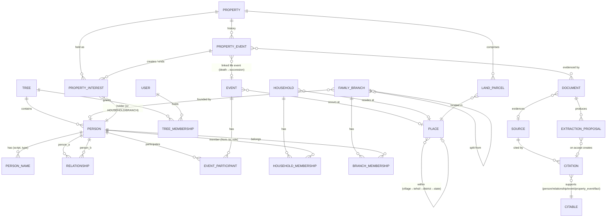
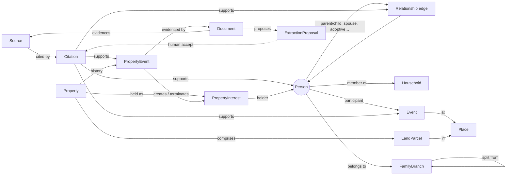

# Domain model

This document explains the model and must be kept in sync with it. The canonical source is the
PostgreSQL schema delivered through Alembic migrations (ADR-0002). If this graph and the migrations
disagree, the migrations are right and this file needs fixing.

Every entity below also has `tree_id` (the tenant boundary), `created_at/by`, `updated_at/by`, and
`version` for optimistic locking. These columns are left out of the diagrams to keep them readable.

## 1. Entity relationship view

## 2. Graph view (how the entities connect)

## 3. Entity notes

| Entity | Key points |
|---|---|
| **Person** | Identity only. Names live in `PersonName` (multiple scripts, alias, maiden/married, honorific). `sex_at_birth` is `male/female/intersex/unknown`, `gender_identity` is optional, and neither decides a parent role. `living_status` is `living/deceased/unknown`, and *unknown is treated as living* for privacy. Gotra, kula, jati, kuladevata, pravara and nakshatra/rashi are stored as sourced *facts* (ADR-0003) rather than flat columns, because they change (a gotra after marriage) and are disputed. |
| **Relationship** | A typed edge `(person_a, person_b, type, subtype, start/end date, status, certainty)`. Types: `parent_child` with subtype `biological/adoptive/dattak/step/foster/guardian/unknown`, and `spouse` with status `married/divorced/widowed/annulled/separated` plus an ordering field. There is one row per fact. Nothing is stored twice. |
| **Household** | Who lives under one roof and when (members have from–to dates). Has a *karta* or head role. Separate from the lineage. |
| **FamilyBranch** | A named lineage segment (e.g. "Madurai branch"), usually founded by one ancestor and possibly split from a parent branch after a partition. Membership can be derived or asserted. |
| **Event** | Birth, death, marriage, upanayana, migration, cremation/shraddha and so on. Has 1..n participants with roles, a `GenealogicalDate`, and optionally a `Place`. |
| **GenealogicalDate** | Value object: `{calendar: gregorian/julian/vikram_samvat/shaka/hijri/…, qualifier: exact/about/before/after/between, from, to, original_text, tithi?}`. Stores a normalised sortable range so queries still work. |
| **Place** | A hierarchy (village → tehsil/taluk → district → state → country) with historical names and optional LGD codes and coordinates. |
| **Source / Citation** | A Source is where information came from (a document, an oral account, a *pandit's pothi*/bahi). A Citation links a Source to one claim, with detail such as page, and a confidence level. |
| **Document** | Stored file: `sha256`, mime, size, scan status, storage key, uploader, sensitivity class. The original is never modified. |
| **ExtractionProposal** | OCR/AI output per field: `{target, field, proposed_value, confidence, model/version, status: pending/accepted/rejected/edited, reviewer}`. Only accepting a proposal writes canonical data (ADR-0004). |
| **Property** | A logical estate (ancestral or self-acquired), classified `ancestral/self_acquired/joint/unknown`. |
| **LandParcel** | Khasra/survey number, khata/khatauni, area plus unit (bigha/guntha/cent/acre as recorded, plus normalised m²), Place. |
| **PropertyInterest** | Who held what share and when: holder (Person, Household or Branch), share as a rational number (numerator/denominator), type (`coparcener/owner/tenant/mortgagee/life_interest`), valid-from/to. |
| **PropertyEvent** | Purchase, inheritance, partition, gift, sale, will, mutation or court order. Carries a date, the interests it ends and creates, and supporting documents. The property timeline is the ordered list of these events. |

## 4. Integrity rules (to enforce in the DB)

- Every foreign key between tree-scoped rows must stay inside one tree. Use composite FKs on
  `(tree_id, id)` so a row can't point into another tree.
- `relationship`: `CHECK (person_a <> person_b)`, plus a unique index on
  `(tree_id, type, subtype, person_a, person_b)` for `parent_child`. Spouse pairs are stored with
  `least/greatest` ordering and have their own unique index.
- Cycle prevention (someone being their own ancestor) is checked in the service layer with a
  recursive CTE before insert. It is also checked by a periodic integrity job.
- Within one `PropertyEvent`, the interests it creates for a property must add up to at most 1. This
  is checked in the service layer and covered by a test.
- Recursive ancestor/descendant queries use `relationship(tree_id, person_b, type)` and
  `(tree_id, person_a, type)` indexes and have a depth limit.
