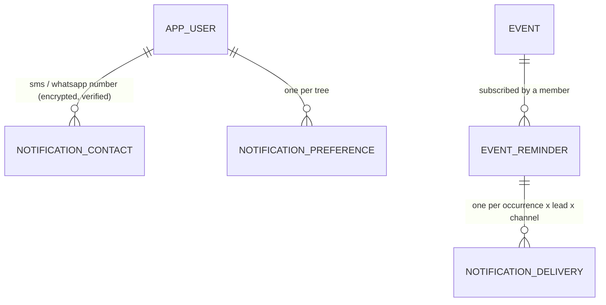
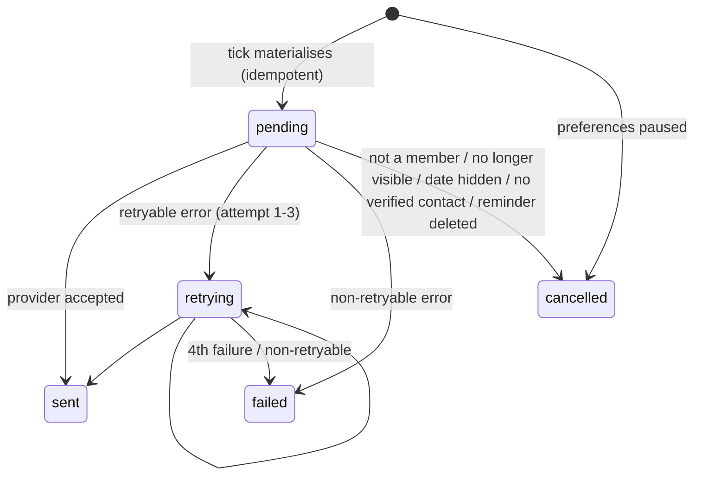

# Event reminder model

Decision: [ADR-0016](adr/0016-reminders-and-notifications.md). Code:
`backend/app/modules/notifications/` (`schedule.py` date arithmetic, `service.py` reminders,
scheduler and delivery, `channels.py` provider adapters), `app/cli/reminders.py` (scheduler).
Providers: [../operations/notification-providers.md](../operations/notification-providers.md).

## 1. Entities

| Table | Key fields | Notes |
|---|---|---|
| `notification_preference` | tree, user, `enabled`, `channels[]`, `timezone` (IANA), `send_hour` (0–23), `default_lead_days[]` | Created (enabled, email) with the member's first reminder. `enabled=false` pauses every reminder in the tree |
| `event_reminder` | event, user, `kind` (birthday / anniversary / memorial / one_time / custom), `recurrence` (none / annual), `lead_days[]` (0–365, ≤ 6), `channels[]`, `note`, `active`, `next_fire_at`, `last_fired_at` | Unique per (event, user). Private to the user |
| `notification_delivery` | reminder, event, user, `channel`, `occurrence_date`, `lead_days`, `scheduled_for`, `status`, `attempts`, `next_attempt_at`, `last_error_code`, `provider`, `provider_message_id`, `sent_at`, `cancelled_reason`, `is_test` | Unique (reminder, channel, occurrence, lead). No message text, no address |
| `notification_contact` | user, `channel` (sms / whatsapp), `address_enc`, `address_hint`, `verified_at`, code hash/expiry/attempts | User-level; AES-GCM (SYSTEM key) |

## 2. Defaults from the event

| Event type | Kind | Recurrence |
|---|---|---|
| birth | birthday | annual |
| marriage | anniversary | annual |
| death, memorial, cremation, burial | memorial (punyatithi / barsi) | annual |
| anything else | one_time | none (or annual if chosen) |

Lead times: "same day" = `[0]`, "1 day before" = `[1]`, "a week before" = `[7]`; any list up to six
values (custom schedule). Channels default to the tree preference.

## 3. Date rules
- Needs a Gregorian `month` and `day` with `exact` precision as visible to the member; year-only,
  approximate, non-Gregorian or redacted dates are refused with a specific code
  (`date_incomplete`, `calendar_not_supported`, `date_hidden`, `date_unknown`).
- One-time reminders also need the year, and a future occurrence (`date_in_past` otherwise; choose
  annual to remember a past date every year).
- 29 February falls on 28 February in common years. Annual reminders never fire before the event's
  own year.
- Fire time: `send_hour:00` local time on `occurrence − lead_days`, converted with `zoneinfo`
  (DST-safe), stored as UTC `next_fire_at`.

## 4. Scheduler and delivery

- `tick()` walks trees (tree bound for RLS), locks due reminders (`FOR UPDATE SKIP LOCKED`),
  creates deliveries for fires in `(max(last_fired_at, now − grace), now]`, advances
  `next_fire_at`, and enqueues new, retry-due and lost (pending > 10 min) deliveries. Running it
  twice, or on two hosts, sends nothing twice.
- `deliver()` locks the delivery, rebuilds a tree context for the recipient and re-checks
  everything (§ADR-0016.3) before composing the message. Retry back-off 2 min / 15 min / 1 h.
- "Send me a test" (`POST /reminders/{id}/test`) creates `is_test` deliveries (5 per hour).

## 5. Messages
- Email (account address): label ("Kamla Iyer's birthday", or the event title), date, "in 7 days",
  "75 years", place, the member's note, a link to the person's events and a link to manage
  reminders. English or Hindi by the member's language.
- SMS / WhatsApp: `Vanshavali: family reminder (birthday) in 7 days, 12 Mar 2027. <link>` — no
  names, places or notes. WhatsApp Cloud API uses an approved template whose parameters are the
  kind, the date and the link.

## 6. API
`GET/PUT /trees/{t}/notification-preferences`, `GET/POST /trees/{t}/reminders`,
`PATCH/DELETE /trees/{t}/reminders/{r}`, `POST /trees/{t}/reminders/{r}/test`,
`GET /trees/{t}/reminders/upcoming?days=30&scope=tree|mine`, `GET /trees/{t}/notifications`
(history), `GET /notification-channels`, `GET/POST /me/notification-contacts`,
`POST /me/notification-contacts/{c}/verify`, `DELETE /me/notification-contacts/{c}`.

## 7. Tests
`backend/tests/test_reminders.py`: schedule arithmetic (time zones, DST, Feb 29, refusals), email end
to end with idempotent ticks, upcoming dates per viewer, visible-date rule, send-time re-check
(privacy change, removed member), privacy of reminders, paused preferences, one-time rules, contact
verification and encryption, SMS content without names, retries to failure, disabled channels,
production refusing mock providers.
