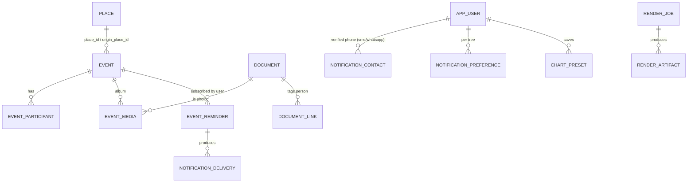
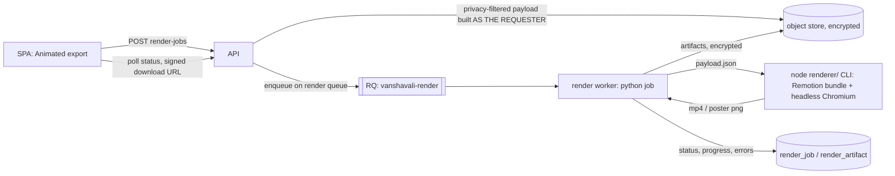

# Milestone: heritage visualization, geo-tagging, life events and reminders

Status: **in progress** (plan written 2 Oct 2026, before any code for this milestone).
Decisions: [ADR-0015](adr/0015-life-events-geotags-event-media.md) (life events, geo-tags, event
photos), [ADR-0016](adr/0016-reminders-and-notifications.md) (reminders and notification delivery),
[ADR-0017](adr/0017-visualizations-and-animated-exports.md) (visualization data APIs and Remotion
exports). Detail docs: [event-reminder-model.md](event-reminder-model.md),
[remotion-rendering.md](remotion-rendering.md),
[../operations/notification-providers.md](../operations/notification-providers.md).

## 1. Audit of what already exists (read before designing)

| Capability asked for | Already in the product | Gap |
|---|---|---|
| Places with local/historical names, hierarchy | `place` (canonical/local/historical names, `place_type`, parent, `lgd_code`, `latitude`/`longitude`, `geocoding_source`) | No administrative fields (district/state/country), no precision or confidence, no map label, no coordinate privacy, no house/shrine/land-parcel types |
| Ancestral village, kuladevata temple | `assertion` (`ancestral_village`, `temple`, `kuladevata`…) with an optional `place_id` | Nothing shows them on a map |
| Property / land parcel location | `property.place_id`, `land_parcel.place_id` | Not on a map |
| Life events | `event` + `event_participant` (typed, `GenealogicalDate` with precision/ranges/calendars, time, place + `place_as_recorded`, own lat/lng, origin place for migration, `privacy_level`, evidence, provenance), citations on events, documents linkable to events | Only 14 structural types; no title, no fine-grained Indian life-event category (naming ceremony, mundan, upanayana…), no significance, no cover photo/album, no tree-wide event list |
| Photos | Document vault (scan → encrypted write-once → previews/thumbnails → signed URLs), `document_link` to person/event/place… | No captions or cover per event, no album, no upload-to-event flow |
| Email | `core/mailer.py` (console/file/SMTP via the job queue, retries) | Only account emails; no reminders, preferences, delivery records, SMS or WhatsApp |
| Charts | Ancestor/descendant graph API (CTE, depth ≤ 25, node cap 500, hidden placeholders) and an SVG tree chart | No fan chart, pedigree, force graph, lifespan/event timelines, map, presets, exports, animation |
| Background jobs | `core/jobs.py` (sync or RQ, `run_job` metrics) | No long-running render queue |

So this milestone **extends** `place`, `event`, the document vault, the mailer and the job queue. It
does not introduce a second place, event or media model.

## 2. Scope

In scope (this milestone):

1. Geo-tagged places (ancestral village, ancestral house, birth/death/event places, temples and
   shrines, properties and land parcels, migration destinations) with precision, confidence,
   provenance and coordinate privacy; a lightweight, tile-free map preview.
2. Important life events: categories, titles, significance, date ranges/approximate dates (existing
   `GenealogicalDate`), place/geo-tag, linked people, photos, documents, citations, visibility.
3. Event photos: multiple per event, cover photo, captions and dates, people tagging, album view,
   strict privacy inheritance.
4. Reminders: per-user opt-in reminders on events (birthdays, anniversaries, memorials, one-time),
   lead times (same day / 1 / 7 / custom days), annual recurrence, time-zone aware, queue-based
   delivery with status, retries and history. Email end-to-end; SMS and WhatsApp behind provider
   adapters with a mock (test) mode.
5. Visualizations: filtered fan chart, dynamic node graph, pedigree chart, family tree chart,
   lifespan timeline, lifetime event timeline, map, with text alternatives, filters, saved presets,
   static export (SVG/PNG/print-to-PDF).
6. Remotion animated exports in an isolated `renderer/` package: render jobs, artifacts, previews
   (poster PNG) and MP4, rendered off the request path.

Out of scope (deferred, named in §13): tithi-based (lunar calendar) anniversaries, push
notifications, live tile maps and geocoding, face detection, narration/music assets, collaborative
storyboards.

## 3. Domain extensions

- **Place** gains `locality`, `district`, `state`, `country`, `map_label`, `location_precision`
  (`exact`, `approximate`, `locality`, `district`, `state`, `country`, `unknown`),
  `geo_confidence`, `geo_note` (provenance), and `coordinate_privacy` (a privacy level for the exact
  coordinates; viewers below it get coordinates coarsened to ~11 km). New place types:
  `ancestral_house`, `shrine`, `land_parcel`, `neighbourhood`. Coordinates stay optional: a place
  without them is still a valid place.
- **Event** gains `title`, `category` (Indian life-event vocabulary, mapped onto the existing
  structural `type`), `significance` (`standard`, `important`, `milestone`) and
  `location_precision` for its own coordinates. The structural `type` keeps driving vitals,
  privacy and GEDCOM; `category` refines it (e.g. `mundan` → `religious_ceremony`).
- **EventMedia** (`event_media`): a photo document in an event's album, with caption, photo date,
  cover flag (at most one per event) and order. People in a photo are ordinary `document_link`
  rows to `person`, so "one photo, many people" reuses the vault's link model.
- **EventReminder**, **NotificationPreference**, **NotificationContact**, **NotificationDelivery**:
  see [event-reminder-model.md](event-reminder-model.md).
- **ChartPreset**: a user's saved chart settings (chart type + validated JSON), optionally shared
  with the tree.
- **RenderJob** and **RenderArtifact**: see [remotion-rendering.md](remotion-rendering.md).

## 4. Data model impact

One Alembic migration (with downgrade) adds 7 tables and extends 2:

| Table | Change | RLS |
|---|---|---|
| `place` | + 9 columns, place-type CHECK widened | already |
| `event` | + 4 columns, life-event category / significance CHECKs | already |
| `event_media` | new; composite FKs to `event` and `document` (cascade), partial unique index for one cover | yes |
| `event_reminder` | new; FK to event (cascade), user; unique (event, user) | yes |
| `notification_preference` | new; unique (tree, user) | yes |
| `notification_delivery` | new; idempotency key unique (reminder, channel, occurrence, lead) | yes |
| `notification_contact` | new; user-level (not tree data) — phone numbers AES-GCM encrypted | no (identity table, service-layer protected like `app_user`) |
| `chart_preset` | new | yes |
| `render_job`, `render_artifact` | new | yes |

`docs/architecture/data-model.md` is regenerated and `domain-model.md` updated.

## 5. API impact (all under `/api/v1`, all tree routes authorised and 404-isolated)

| Area | Endpoints |
|---|---|
| Places | `GET/POST/PATCH /trees/{t}/places…` extended with geo fields; `?geotagged=true` filter |
| Life events | `POST/PATCH /trees/{t}/events` extended; `GET /trees/{t}/life-events` (tree-wide, cursor, filters: person, category, significance, years, geotagged) |
| Event photos | `GET/POST /trees/{t}/events/{e}/media` (multipart upload or link an existing photo), `PATCH/DELETE …/media/{m}` |
| Reminders | `GET/PUT /trees/{t}/notification-preferences`, `GET/POST /trees/{t}/reminders`, `PATCH/DELETE /trees/{t}/reminders/{r}`, `POST …/reminders/{r}/test`, `GET /trees/{t}/reminders/upcoming`, `GET /trees/{t}/notifications` (delivery history) |
| Contacts | `GET /notification-channels`, `GET/POST /me/notification-contacts`, `POST …/{c}/verify`, `DELETE …/{c}` |
| Visualization data | `GET /trees/{t}/viz/ancestry` (fan + pedigree), `/viz/neighbourhood` (graph, progressive), `/viz/lifespans`, `/viz/people/{p}/story` (event timeline), `/viz/map` |
| Presets | `GET/POST /trees/{t}/chart-presets`, `PATCH/DELETE …/{id}` |
| Render jobs | `POST/GET /trees/{t}/render-jobs`, `GET …/{id}`, `POST …/{id}/cancel`, `POST …/{id}/artifacts/{a}/download-url`, `GET /render-files/{token}` |

Frontend types are regenerated from OpenAPI (`npm run gen:api`).

## 6. UI impact

- Person profile: new **Events** (important life events with category, cover photo, reminder bell),
  **Photos** (album across events and person-tagged photos) and **Visualizations** tabs; the
  **Timeline** tab becomes the lifetime event timeline (grouped by decade or detailed, slideshow).
- Tree pages (the app's tree routes are `/t/:treeId/...`, so the suggested
  `/tree/[treeId]/visualizations` maps to `/t/:treeId/visualizations`): `visualizations` (fan,
  graph, pedigree, family tree, lifespan, event timeline, map; filters; presets; export and animated
  export), `events`, `reminders` (my reminders, preferences, contacts, history), `timeline`
  (tree-wide lifespans and event chronology).
- Event dialog: category, title, significance, visibility, geo-tag (place with coordinates, or
  coordinates with precision), and after saving, the photo album and reminder settings.
- Places page: geo fields, precision and a map preview.

## 7. Export and rendering architecture

- The payload is built at request time with the requester's permissions, so a render can never
  contain more than the requester could see on screen. It is stored encrypted and never logged.
- `renderer/` is an isolated Node package (Remotion 4). Compositions: `FanChart`, `PedigreeChart`,
  `FamilyTree`, `LifespanTimeline`, `EventTimeline`, sharing a theme, a title card and optional
  audio/narration slots (unused unless provided).
- Static exports are produced in the browser from the same SVG the user sees (SVG/PNG download and
  a clean print stylesheet for PDF).
- Backends: `remotion` (real), `stub` (tests: a deterministic poster PNG and a placeholder file),
  `disabled` (API answers `503 render_unavailable`). See [remotion-rendering.md](remotion-rendering.md).

## 8. Reminder architecture

Per-user, opt-in subscriptions on events; a scheduler tick (`python -m app.cli.reminders tick`,
cron every 5 minutes, or `--loop`) materialises due deliveries idempotently and enqueues them;
channel adapters (email via the existing mailer, SMS and WhatsApp via provider adapters with a mock
mode) report a result that is recorded on `notification_delivery`. Visibility is re-checked at
send time as the recipient. Full design: [event-reminder-model.md](event-reminder-model.md).

## 9. Geospatial considerations

- Coordinates are `NUMERIC(9,6)` (≈ 0.1 m) and optional; precision records what they mean. No
  PostGIS: distances and bounding boxes are computed in Python for ≤ a few thousand points per
  tree, which is the expected size. PostGIS is a later option behind the same API.
- No third-party tiles or geocoders by default: they would send family locations to a third
  party, need CSP changes, and drawing India's external boundary has legal requirements (Survey of
  India). The map preview is a projected, tile-free plot (points, migration arcs, labels, a
  graticule) with an "open in OpenStreetMap" link per point that the user chooses to follow.
- Coordinates of an exact `ancestral_house` or a living person's residence are sensitive: places
  carry `coordinate_privacy`; viewers below it get coordinates rounded to 0.1° and
  `location_precision` reported as `approximate`; public pages never get coordinates.

## 10. Risks

| Risk | Mitigation |
|---|---|
| Remotion's licence: free for individuals and companies of ≤ 3 people; larger organisations need a company licence | Recorded in ADR-0017 and the go-live checklist; rendering is isolated behind a backend switch so it can be disabled or replaced |
| Rendering is CPU/memory heavy (Chromium + ffmpeg) | Separate RQ queue and worker; concurrency 1 per worker; per-user queue limits; duration and size caps; timeouts |
| Private data leaking through charts, exports, videos or reminders | One privacy path (serialiser + `visible_subjects`) for every viz API; payloads built as the requester; artifacts downloadable only by the requester (and tree admins); reminders re-checked at send time; tests for each |
| SMS/WhatsApp providers unavailable in the sandbox | Adapters + mock mode; live adapters ship disabled until credentials and templates exist |
| Large trees overwhelm the browser | Server caps (generations ≤ 10 for fan/pedigree, radius ≤ 3 and node cap for the graph, ≤ 500 lifespans), progressive expansion, canvas-free SVG with simple layouts, no eager whole-tree loads |
| Calendar subtleties (Feb 29, non-Gregorian dates, tithis) | Annual reminders need a Gregorian month/day; Feb 29 falls on Feb 28 in common years; lunar anniversaries deferred |

## 11. Accessibility

Every chart has a text alternative (summary sentence + data table or list), keyboard-focusable
nodes that open an accessible detail panel, a visible legend, filters as native form controls,
reduced-motion support (no auto-animation in the UI when `prefers-reduced-motion`), and colour
choices that never carry meaning alone (pattern/label redundancy). Animated exports are an extra,
never the only way to read the data. The map lists every point in a table.

## 12. Privacy implications

- Charts use the same visibility as the rest of the API: hidden people are placeholders (never
  names, dates or places); living people get year-only dates where the field rules say so.
- Event photos inherit the strictest of the event's and the principal person's privacy level by
  default and keep the vault's own access checks (STANDARD vs VAULT, grants, signed URLs).
- Exact coordinates follow `coordinate_privacy`; public pages never show coordinates.
- Reminders are opt-in per user; phone numbers are encrypted at rest, verified before use, masked
  in every response and log; delivery records hold no message bodies; SMS/WhatsApp texts never
  contain living people's names or full dates (they are sent through third parties).
- Render artifacts reflect the requester's view and are downloadable only by the requester and
  tree admins; payloads are encrypted at rest and swept with the job.

Threat model entries T34–T38 and privacy model §7 record the controls and tests.

## 13. Implementation phases

| Phase | Content | Exit criteria |
|---|---|---|
| A | Place geo fields, event extension, event media, life-events API, event UI, places map preview | API + Vitest tests; migration roundtrip |
| B | Reminder/preference/contact/delivery model, scheduler, email channel, SMS/WhatsApp adapters (mock + live adapters), reminders UI | Email reminder delivered through the file backend in tests; retries and cancellation tested |
| C | Viz data APIs; fan, graph, pedigree, family tree, lifespan, event timeline, map UIs; presets; static export | Privacy tests for every viz API; component tests for filters |
| D | `renderer/` Remotion package, render jobs, artifacts, worker queue, render UI | A real MP4 rendered by the renderer test; backend lifecycle tests with the stub; one real end-to-end render recorded |
| E | Hardening, accessibility, performance, E2E, docs, status | Full lint/type/test/build/E2E pass |

Deferred: lunar-calendar (tithi) anniversaries, push notifications, live map tiles and geocoding
(needs a provider decision and boundary compliance), narration/music assets, face tagging, sharing
rendered videos outside the tree.

## 14. Performance considerations

- Viz endpoints return compact, purpose-built payloads (ids, display name, years, flags), not full
  `PersonOut`; batch loading (`load_subjects`, one events query, one place query) avoids N+1.
- Fan/pedigree reuse the recursive CTE walk with depth caps; the graph is radius-limited and
  expanded on demand; lifespans are capped and paginated; the map aggregates points per place.
- Frontend: charts are lazy-loaded routes; the force graph runs a bounded number of ticks and
  stops; long lists (events, lifespans) render in windows.
- Rendering never runs in a web request (separate queue); payload size and frame counts are capped.
