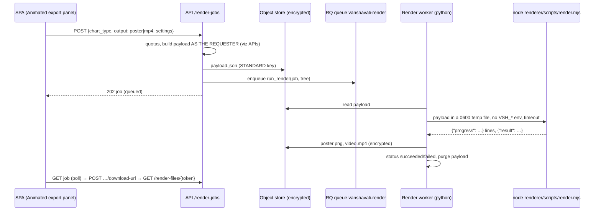

# Remotion rendering (animated exports)

Decision: [ADR-0017](adr/0017-visualizations-and-animated-exports.md). Code: `renderer/` (Node),
`backend/app/modules/render/` (jobs, payloads, worker), `frontend/src/components/viz/AnimatedExport.tsx`.

## 1. Flow



In `VSH_JOB_MODE=sync` (tests, local development) the render runs inline in the request; in
production (`rq`) it runs on the render worker.

## 2. Payload

`{"composition": "FanChart", "props": RenderProps}` — see `renderer/src/types.ts`. Built by
`app/modules/render/payloads.py` from the visualization APIs, so it carries only what the requester
may see (hidden people are `{"hidden": true, "person": null}`; living people's dates are year-only
where the field rules say so). Event-timeline photos are embedded as `data:` URIs only when the
requester may open the document's content, at most 12 photos of ≤ 600 KB (preview or thumbnail
derivative, never the original). The payload is capped at `VSH_RENDER_MAX_PAYLOAD_BYTES` (8 MB).

| Chart | Composition | Settings used | Length |
|---|---|---|---|
| fan | `FanChart` | root, generations (≤ 6), colour by | 2.5 s title + 1.2 s × generations + 4 s |
| pedigree | `PedigreeChart` | root, generations (≤ 5 columns drawn) | same |
| family_tree | `FamilyTree` | root, direction, generations (≤ 60 people) | ≤ 40 s |
| lifespan | `LifespanTimeline` | optional root, generations, branch (≤ 40 rows) | ≤ 40 s |
| event_timeline | `EventTimeline` | root, include photos (≤ 30 events) | 4 s per event |

Videos are 1280×720, 30 fps, H.264 MP4, capped at 120 s. Colour keys come with a legend; colour is
never the only carrier of meaning (labels on every node).

Themes: `heritage` (default), `dusk`, `minimal`. Branding: title, subtitle, tree name, footer with
the generation date. `music` / `narration` are optional audio slots (`{src, volume}`); the API
sends `null` today, so videos are silent until audio assets exist.

## 3. Outputs and access
- `poster` output: one PNG (a frame at ~70% of the animation) — the quick preview.
- `mp4` output: poster + video. Progress is written to `render_job.progress` every 5%.
- Artifacts are `render_artifact` rows pointing at encrypted objects
  (`STANDARD/<tree>/render/<job>/…`). Only the requester and tree admins can see jobs and request
  download URLs; URLs last ≤ 5 minutes, are bound to the user and are re-authorised at download.
- Deleting a job removes its artifacts. The orphan sweep (`app.cli.maintenance sweep-orphans`)
  knows render keys.

## 4. Failure handling
`render_job.status`: `queued` → `running` → `succeeded` | `failed` | `cancelled`. Failures record a
short code (`renderer_not_installed`, `render_timeout`, `bundle_missing`, `unknown_composition`,
`render_failed`, `internal_<type>`) and a fixed message; the renderer's own output is never stored
or logged (it could quote names). The payload is purged in every terminal state.

Limits: `VSH_RENDER_MAX_ACTIVE_PER_USER` (3), `VSH_RENDER_MAX_PER_DAY_PER_TREE` (50),
`VSH_RENDER_TIMEOUT_SECONDS` (600).

## 5. Running it

```
cd renderer && npm ci && npm run bundle        # build/bundle (webpack) once per release
npm test                                       # real renders: all posters + two MP4s, ffprobe check
npm run studio                                 # Remotion Studio with fictional sample props

# API side
VSH_RENDER_BACKEND=remotion VSH_RENDERER_DIR=../renderer uv run uvicorn app.main:app
python -m app.cli.worker --queue render         # production render worker
```

Chromium: `REMOTION_BROWSER_EXECUTABLE` / `VSH_RENDERER_BROWSER_EXECUTABLE`, else a Playwright
headless shell if present, else Remotion downloads Chrome Headless Shell (`npx remotion browser
ensure`, done in the Docker image). Fonts: Noto (Devanagari, Tamil, …) must be installed on the
render host for Indic names (`fonts-noto-core`, `fonts-noto-extra` in the image).

Each render opens **one** Chromium and shares it across `selectComposition`, `renderStill` and
`renderMedia` (`scripts/browser.mjs`). Remotion allows a fixed 25 s for Chrome to accept the
connection, which a cold first start can exceed, so that launch, and only a launch timeout, is retried
up to three times (`browser_launch_retry_N` on stderr). Any other launch error fails at once. The smoke test (`npm test`) prints the retry count
for every render and a total, so a cold start that a retry absorbed stays visible in CI logs.
Remotion abandons a timed-out Chrome without killing it, and that process would keep `render.mjs`
alive forever. So each timed-out attempt's new child processes are killed before the retry, and
a render kills any remaining descendants and exits explicitly (`scripts/procs.mjs`, Linux `/proc`).
The smoke test gives each render 5 minutes, and the CI job has `timeout-minutes: 30`.

`render.mjs` stderr, in order:
1. `browser=<path>` (or `browser=remotion-headless-shell`): which browser this run uses (see the
   selection order above). It is written first, so a failed render never ends with it.
2. `browser_launch_retry_N` for each retried launch timeout.
3. On failure, the last line. Setup errors (`usage`, `bundle_missing`, `unknown_composition`) exit 2
   with that code as the only line. Any other failure exits 1 with the error's stack, so the API's
   rule (use the last line as the error code only if it is short and has no spaces, otherwise
   `render_failed`) never reports a stack frame or a name as a code.

Deployment: `deploy/render-worker/Dockerfile` (Node + bundle + Chromium libraries + Python worker)
and the opt-in `render-worker` service (compose profile `render`). Give it 2 CPUs and 3 GB; one job
at a time per worker; `REMOTION_CONCURRENCY` sets frame-render parallelism.

## 6. Licence
Remotion is licensed under the Remotion License (free for individuals, non-profits and companies
of up to 3 people; a company licence is needed above that). Check before enabling in production;
the go-live checklist has an item for it.

## 7. Tests
- `renderer`: `npm run typecheck`, `npm test` (real renders, CI job `renderer`).
- `backend/tests/test_render_jobs.py`: lifecycle, payload-as-requester privacy, photo embedding,
  access control, signed URLs, quotas, failures (stub renderer); `test_real_remotion_render_end_to_end`
  runs the real renderer through the API when `VSH_TEST_REMOTION=1` (CI `renderer` job).
- Frontend: `AnimatedExport.test.tsx`; Playwright `heritage-visualization.spec.ts` requests a
  preview (stub renderer in E2E unless `VSH_E2E_RENDER_BACKEND=remotion`).
